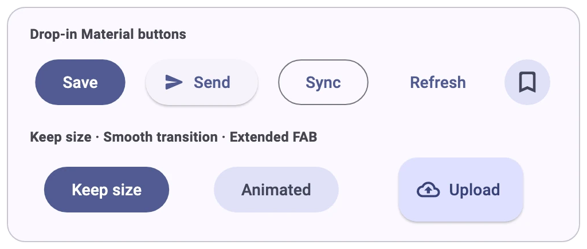

# material_async_button

[](https://pub.dev/packages/material_async_button)
[](https://pub.dev/packages/material_async_button/score)
[](https://github.com/esenmx/material_async_button/actions/workflows/ci.yaml)
[](LICENSE)

Drop-in async versions of Flutter's Material buttons. Pass an async callback to
`onPressed` and the button shows a spinner until its `Future` completes — with
double-tap protection, `mounted` safety, and zero boilerplate state.



## Quick start

```sh
flutter pub add material_async_button material_ui
```

```dart
import 'package:material_async_button/material_async_button.dart';
import 'package:material_ui/material_ui.dart';

Widget saveButton(Future<void> Function() save) {
  return ElevatedAsyncButton(
    onPressed: save, // shows a spinner until save() completes
    child: const Text('Save'),
  );
}
```

> **Note:** Since version 4, the buttons target
> `package:material_ui/material_ui.dart`. Depend on `material_ui` and import
> it (migrate with `dart fix --apply --code=migrate_design_widgets`); with
> `package:flutter/material.dart`, the buttons ignore your `ThemeData`.

## Drop-in buttons

| Material | Async counterpart | Variants |
| --- | --- | --- |
| `ElevatedButton` | `ElevatedAsyncButton` | `.icon` |
| `FilledButton` | `FilledAsyncButton` | `.tonal`, `.icon`, `.tonalIcon` |
| `OutlinedButton` | `OutlinedAsyncButton` | `.icon` |
| `TextButton` | `TextAsyncButton` | `.icon` |
| `IconButton` | `IconAsyncButton` | `.filled`, `.filledTonal`, `.outlined` |
| `FloatingActionButton` | `FloatingActionAsyncButton` | `.small`, `.large`, `.extended` |

Every Material parameter (`style`, `focusNode`, `autofocus`, `clipBehavior`,
`statesController`, etc.) is forwarded verbatim.

## Common options

- **Keep width:** pass `maintainSize: true` so the button keeps its idle width
  while loading.
- **Animate the swap:** pass `transitionBuilder` (e.g. `AnimatedSize` +
  `AnimatedSwitcher`).
- **Configure once:** register `AsyncButtonTheme` in `ThemeData.extensions` to
  set defaults app-wide.
- **Trigger from outside:** pass an `AsyncButtonController` (e.g. to submit from
  a `TextField`'s keyboard "Done" button).

## Guides

- [Theming and animations](doc/theming.md) — `AsyncButtonTheme`,
  `maintainSize`, `minLoadingDuration`, `disableWhileLoading`,
  `transitionBuilder`, and `AsyncButtonSpinner`.
- [Controller and custom buttons](doc/controller.md) — `AsyncButtonController`
  (`trigger`, `reset`, `canTrigger`) and the low-level `AsyncButton` escape
  hatch.
- [Behavior and errors](doc/behavior.md) — loading vs disabled state, error
  handling, and `.icon` / FAB details.

## Agent skill

This package ships an agent skill in `skills/material-async-button-usage/`.
Install it into your project's agent config with:

```sh
dart run skills@ get --package material_async_button --all
```

## Contributing

See [CONTRIBUTING.md](CONTRIBUTING.md).

## License

MIT — see [LICENSE](LICENSE).
